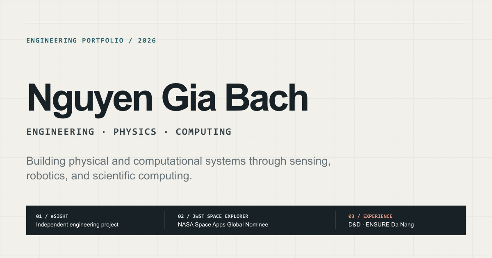

# Nguyen Gia Bach — Portfolio



An English-language engineering portfolio for Nguyen Gia Bach, focused on physics, sensing, robotics, scientific computing, and documented project work.

**Live website:** [nguyen-gia-bach-portfolio.vercel.app](https://nguyen-gia-bach-portfolio.vercel.app)

## Highlights

- Technical-editorial homepage with eSight as the flagship independent engineering project
- Selected engineering work, supervised engineering experience, recognition, capability evidence, leadership, and compact academic programs
- Four detailed project case studies: eSight, JWST Space Explorer, AstroVerse, and Vibe Coding Platform
- English metadata, canonical URLs, Open Graph content, JSON-LD, robots, and sitemap
- Responsive, keyboard-accessible interface with reduced-motion support
- Purposeful image placeholders that can be replaced without changing the layout

## Routes

| Route | Content |
| --- | --- |
| `/` | Portfolio homepage |
| `/projects/jwst-deep-space-explorer` | JWST Space Explorer case study |
| `/projects/astroverse` | AstroVerse case study |
| `/projects/esight` | eSight engineering design case study |
| `/projects/esight-or-robotics` | Permanent redirect to the eSight case study |
| `/projects/vibe-coding-platform` | Vibe Coding Platform case study |

## Technology

- Next.js 16
- React 19
- TypeScript
- Custom CSS
- Vercel

## Local development

Requirements: Node.js 24 and pnpm.

```bash
pnpm install
pnpm dev
```

Open [http://localhost:3000](http://localhost:3000).

## Validation

```bash
pnpm lint
pnpm build
```

The production build prerenders the homepage, all four project routes, `robots.txt`, and `sitemap.xml`.

## Deployment

The repository is configured for Vercel's Next.js preset. The production branch is `main`, and pushes to it create production deployments. Other branches can be used for preview deployments.

The canonical origin is resolved in this order:

1. `NEXT_PUBLIC_SITE_URL`
2. Vercel's `VERCEL_PROJECT_PRODUCTION_URL`
3. `http://localhost:3000` during local development

No backend or database is required.
